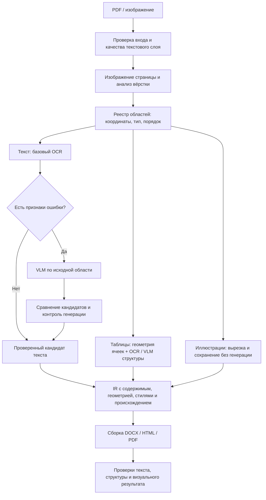

# Улучшение OCR-архитектуры с VLM

Дата: 9 октября 2026 года. Исследование основано на официальных документах моделей, исходниках установленного SDK и локальном сравнении на Пак1. Новые модели в рамках исследования не устанавливались, новый OCR-прогон не выполнялся. Ниже отделены наблюдения от предлагаемых изменений.

## Краткий вывод

Рекомендуется гибридный процесс: независимая геометрия страницы, обычный OCR как базовый кандидат, VLM для выбранных сложных областей, проверка кандидатов и детерминированная сборка документа. Полная замена текущего процесса ответом GLM/Ollama пока ухудшает результат.

Первая задача — проверить корректность GLM inference и завершения генерации. Вторая — отделить распознавание текста от восстановления таблиц, иллюстраций и оформления. Третья — принимать ответ VLM только после контроля качества, сохраняя исходные кандидаты.

## 1. Что установлено на нашем проекте

На одной странице Пак1 относительно DOCX:

| Показатель | Docling | GLM/Ollama |
|---|---:|---:|
| CER | 40,21% | 147,97% |
| WER | 49,66% | 160,40% |
| Precision слов | 75,18% | 36,31% |
| Recall слов | 71,14% | 89,93% |
| F1 | 73,10% | 51,74% |
| Вставки слов | 16 | 220 |
| OCR страницы | 7,21 с | 280,54 с |

GLM возвращает многие нужные слова, но добавляет избыточный текст. Повторы видны в сохранённом ответе SDK ещё до экспорта. Это подтверждает дефект текущего процесса, но одна страница не характеризует модель на всём классе документов. Различия эталона и PDF тоже нужно отдельно проверить.

Локальный анализ кода показывает дополнительные ограничения:

- Ответ SDK не сохраняет в нашем IR причину остановки, число сгенерированных токенов и признаки усечения.
- В установленном SDK текст форматируется в Markdown; затем наше приложение переносит его в позиционные блоки. Это может добавлять переносы и служебную разметку.
- Таблица HTML преобразуется в сетку с равномерно рассчитанными координатами ячеек. Исходные ширины столбцов и высоты строк не измеряются.
- IR хранит типы, текст и bbox, но не полный набор исходных стилей: шрифт, размер, интервалы, отступы и оформление границ. Точно восстановить их из таких данных нельзя.
- PASS проверяет ряд условий экспорта. Он не означает низкий CER, правильный шрифт или идентичность иллюстраций.
- Изображения должны сохраняться независимо от того, смогла ли VLM прочитать соседний текст. Ошибка сопоставления областей и файлов была обнаружена и исправлена; полного визуального подтверждения исправления пока нет.

## 2. Что говорят источники

### GLM: поддержка русского и правильные задачи

Карточка GLM-OCR перечисляет русский язык и документирует три задания: `Text Recognition:`, `Table Recognition:`, `Formula Recognition:`. Это основание использовать специальные команды для каждого типа области. Языковая поддержка не гарантирует качество конкретного скана. [Официальная карточка](https://huggingface.co/zai-org/GLM-OCR/blob/main/README.md).

### Повторы в Ollama

В issue #220 описано повторение распознанного текста через Ollama. В открытом PR #239 предлагаются специальные команды и stop-последовательности. Это сообщение пользователя и предложение участника, а не подтверждённое исправление всех случаев. Наш процесс уже использует специальные команды, поэтому этого условия недостаточно. [Issue #220](https://github.com/zai-org/GLM-OCR/issues/220), [PR #239](https://github.com/zai-org/GLM-OCR/pull/239).

### Альтернативный inference

Официальная документация Transformers показывает прямой запуск GLM-OCR. Он полезен как контрольный вариант для сравнения с Ollama при одинаковых изображениях и заданиях. Сам переход на другой backend не гарантирует улучшения. [Transformers GLM-OCR](https://github.com/huggingface/transformers/blob/main/docs/source/en/model_doc/glm_ocr.md).

### Альтернативная VLM

PaddleOCR-VL-1.6 — актуальный кандидат для сравнения. Документация описывает полный процесс анализа вёрстки и распознавания областей и предупреждает, что запуск одной VLM не эквивалентен этому процессу. Серия заявляет поддержку 109 языков; это не заменяет наш русский тест. vLLM/SGLang не работают нативно на Windows; доступны другие способы inference, но совместимость конкретного окружения нужно проверять. [PaddleOCR-VL](https://www.paddleocr.ai/latest/en/version3.x/pipeline_usage/PaddleOCR-VL.html).

В работе по версии 1.6 исследуется уточнение плохо обработанных областей. Это поддерживает идею повторной обработки отдельных сложных регионов; перенос такой идеи в наш сервис — инженерная гипотеза, а не воспроизведение результатов авторов. [Техническая работа](https://arxiv.org/abs/2606.03264).

## 3. Предлагаемая архитектура

### Анализ вёрстки

Сравнить PP-DocLayoutV3 с текущим анализом Docling на одних страницах. Зафиксировать независимый реестр областей, сохранять detector bbox, polygon и порядок. Ответ VLM не должен произвольно менять геометрию. Выбирать анализатор по оценке, а не автоматически считать новый лучшим.

### Маршрутизация текста

Базовый OCR даёт первичный текст, строки и confidence. Подозрительные области отправляются в VLM: низкая уверенность, пропуски, аномальные символы, расхождение нескольких кандидатов. Порог confidence нужно откалибровать — значения разных моделей нельзя напрямую сравнивать.

VLM получает изображение области; текст другого OCR можно использовать при последующем сравнении, но не подсказывать модели как безусловный ответ. Это уменьшает риск копирования ошибочного кандидата.

### Выбор результата

Сохранять оба кандидата и основание выбора. Согласие моделей является сигналом, но не доказательством правильности. Не выбирать автоматически более длинный ответ или более литературный текст. Для имён, дат, номеров и сумм важны символы исходника, а не смысловая правдоподобность.

При конфликте: один ограниченный повторный запрос с другим масштабом/обрезкой; затем предупреждение и явный статус сомнительной области. Не запускать бесконечные retries.

### Таблицы

Использовать VLM для структуры и текста вместе с отдельным определением границ ячеек. Сопоставлять HTML-ячеек с измеренными строками/столбцами, проверять rowspan/colspan, отсутствие пересечений и сохранение текста. Равномерная сетка остаётся помеченным fallback. На Пак1 таблиц нет, поэтому табличное улучшение там проверить нельзя.

### Иллюстрации

Хранить устойчивую связь `region_id → image asset → output object`. Координаты изображения, bbox вырезки и bbox размещения хранить отдельно. Нельзя считать число inline-объектов DOCX точной разметкой визуальных картинок. Проверять существование, содержимое, размер и положение объекта в каждом формате.

### Оформление

Добавить в IR стили абзацев и строк: оценку размера/начертания шрифта, выравнивание, отступы, межстрочный интервал; для таблиц — измеренные ширины, высоты, границы и фон. Оценки со скана должны иметь происхождение и неопределённость: точное название шрифта не всегда восстанавливаемо.

После экспорта рендерить документ и проверять фактические пересечения и переполнение. Расчётный bbox до экспорта не гарантирует одинаковую вёрстку в Word и браузере.

## 4. Приоритетные эксперименты

| Приоритет | Эксперимент | Что он проверяет |
|---|---|---|
| 1 | Одинаковые кропы: Ollama против официального Transformers | Ошибка модели или особенности inference |
| 1 | Сохранять raw output, токены, stop reason, время и crop size | Где начинается повтор, усечение и потеря качества |
| 1 | Контроль завершения генерации и повторов | Снижение вставок без удаления настоящего текста |
| 2 | Размер и поля кропа, PNG, масштаб | Потери контекста и читаемости символов |
| 2 | Разделить крупные текстовые области на связные фрагменты | Качество и время коротких заданий |
| 2 | Базовый OCR + выборочная VLM | Выигрыш гибрида относительно обоих движков |
| 3 | PaddleOCR-VL-1.6 на тех же кропах | Качество другого специализированного VLM |
| 3 | Измеренные ячейки и расширенный IR стилей | Восстановление структуры и оформления |

Для генерации: проверять EOS и шаблон модели, фиксировать параметры и версию весов. Предел ответа рассчитывать по размеру задания; ответ, остановленный лимитом, помечать усечённым. Stop на тройных обратных кавычках нельзя включать без проверки: он способен отрезать допустимое содержимое. Повторы следует выявлять по циклам внутри конкретной области; глобальная дедупликация удалит законные повторяющиеся строки таблиц.

Причина текущих 17–18 секунд на большинство областей пока не установлена. Гипотеза: значительная часть времени тратится на лишнюю генерацию. Нужны token counts и stop reason; одна длительность этого не доказывает.

## 5. Оборудование и развёртывание

На текущем GPU с 4 ГБ памяти предпочтителен последовательный inference и анализ вёрстки на CPU. Увеличение batch может вызвать нехватку памяти. Для контрольного Transformers-прогона возможны CPU или отдельный GPU-сервер; CPU будет медленнее, но подходит для проверки нескольких кропов. Для серверной конфигурации объём VRAM определять измерением с выбранными разрешением, precision и длиной контекста.

Не следует сразу заменять F16/BF16 более сильной квантизацией: сначала измерить качество исходного пути. Смена precision — отдельный эксперимент. Не скачивать одновременно несколько крупных моделей до выбора сравниваемых вариантов.

## 6. Как измерять улучшение

Пока пользователь разрешил только Пак1 — эксперименты ограничивать этой парой. Выделить и сверить вручную GT для нескольких текстовых областей: это позволит отделить ошибки порядка документа от качества букв и различий DOCX/PDF. Эталон не подаётся в распознавание. Пак1 пригоден для отладки; для подтверждения обобщения позже потребуется отдельно согласованный независимый набор.

Метрики: CER/WER документа и кропов; S/D/I отдельно; recall и precision; частота повторов, усечений, ошибок страниц; OCR-время и число VLM-запросов. Для изображений — соответствие объектов и геометрии; для вёрстки — пересечения, переполнение, сравнение отрендеренных страниц. TEDS/GriTS требуют таблиц и подходящей разметки, в текущей паре неприменимы.

Предложение по приёмке следующего шага: гибрид уменьшает CER/WER относительно базы, не снижает полноту, не теряет подтверждённые изображения и не добавляет пересечений. Численные пределы времени и ошибок согласовать после проверки эталона. Отдельно проверять числа и имена. Нельзя оптимизировать только recall — наш GLM уже показал, почему этого недостаточно.

## 7. Порядок реализации

1. Добавить диагностический контракт VLM и воспроизводимый тест одинаковых кропов.
2. Проверить официальный GLM backend и завершение генерации. Если повторы сохраняются — не принимать такой кандидат.
3. Добавить маршрутизацию OCR/VLM, выбор кандидата и явные причины fallback.
4. Уточнить геометрию таблиц, независимый путь картинок и IR оформления.
5. Провести повторное сравнение на Пак1. Новые документы подключать только после разрешения пользователя.
6. Дообучение рассматривать лишь после этих шагов, если останутся устойчивые доменные ошибки. Официальный GLM пример использует LLaMA-Factory, но одного документа для надёжного дообучения и независимой оценки недостаточно. [Пример авторов](https://github.com/zai-org/GLM-OCR/blob/main/examples/finetune/README.md).

Исследование не доказывает, что предложенная архитектура уже улучшила метрики. Это обоснованный план экспериментов и изменений, а не результат нового benchmark.
